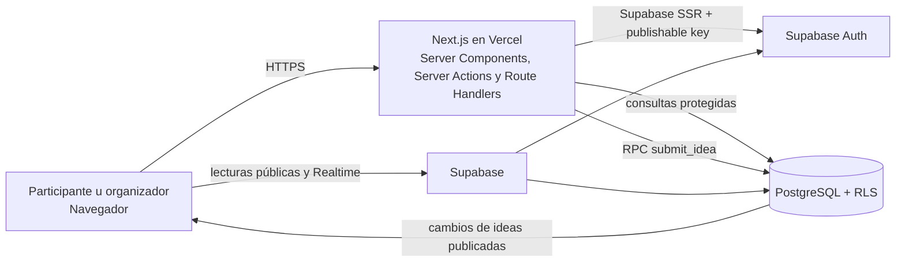

# Arquitectura del sistema

## Resumen

El MVP es una aplicación web construida con Next.js App Router y React, desplegada en Vercel. Supabase provee PostgreSQL, autenticación, políticas Row Level Security (RLS) y Realtime. No hay un backend separado ni un contenedor de aplicación en producción.

## Tecnologías y responsabilidades

| Componente | Tecnología | Responsabilidad |
| --- | --- | --- |
| Interfaz y lógica web | Next.js 16 App Router, React 19, TypeScript | Páginas, formularios, Server Actions, callback de Auth y renderizado. |
| Hosting | Vercel | Compilar y ejecutar Next.js; despliegues asociados a GitHub. |
| Identidad | Supabase Auth | Cuentas de organizadores, sesiones, confirmación de email y recuperación de contraseña. |
| Datos | Supabase PostgreSQL | Actividades, participantes, ideas, autoría, restricciones y funciones SQL. |
| Acceso a datos | RLS y grants PostgreSQL | Aislar actividades por propietario y limitar los datos visibles públicamente. |
| Actualización en vivo | Supabase Realtime | Propagar cambios de ideas del muro sin refrescar la página. |
| Desarrollo local | Supabase CLI y Docker Desktop/WSL 2 | Ejecutar los servicios locales y aplicar migraciones. |

La app usa `@supabase/ssr` para mantener la sesión de organizador en cookies. Las Server Actions y el callback de autenticación se ejecutan en Next.js. El navegador puede leer las columnas públicas permitidas por SQL y RLS; no debe recibir secretos de servidor.

## Flujos principales

### Organizador

1. Se registra o inicia sesión con email y contraseña en Supabase Auth.
2. Next.js conserva/renueva la sesión mediante cookies.
3. El panel consulta actividades y datos privados usando la sesión del organizador; RLS comprueba `owner_id`.
4. El organizador crea, configura, modera, cierra, reabre o elimina sus actividades.
5. La recuperación de contraseña envía un enlace de Supabase Auth a `/auth/callback`; el callback crea la sesión de recuperación y lleva a `/restablecer-contrasena`.

### Participante y muro público

1. El participante abre `/a/[code]`, sin crear una cuenta, e ingresa nombre, apellido, email e idea.
2. La Server Action valida los campos y llama a la RPC `submit_idea`.
3. La función SQL valida que la actividad siga abierta, registra al participante, la idea y su relación de autoría en una transacción; el modo define si queda `published` o `pending`.
4. `/muro/[code]` lee únicamente ideas publicadas. Realtime notifica los cambios de ideas; los datos identificatorios se mantienen en tablas separadas y no forman parte del payload público.

## Rutas de aplicación

| Ruta | Uso |
| --- | --- |
| `/` | Página pública de presentación. |
| `/crear-cuenta` | Registro de organizadores. |
| `/ingresar` | Inicio de sesión. |
| `/recuperar-contrasena` | Solicitud de enlace de recuperación. |
| `/auth/callback` | Intercambio del código de Auth por una sesión. |
| `/restablecer-contrasena` | Guardar una contraseña nueva con una sesión de recuperación válida. |
| `/panel` | Actividades del organizador. |
| `/panel/actividad/[id]` | Participantes, ideas y controles de la actividad propietaria. |
| `/a/[code]` | Formulario público de participación. |
| `/muro/[code]` | Proyección pública de ideas aprobadas, con QR y Realtime. |

## Seguridad y límites

- Solo existen cuentas de organizadores. Los participantes no tienen cuenta; el email no se verifica al enviar ideas.
- `NEXT_PUBLIC_SUPABASE_URL` y `NEXT_PUBLIC_SUPABASE_PUBLISHABLE_KEY` son configuración pública. RLS y las funciones SQL son la frontera de autorización.
- No se requiere ni se debe configurar una clave `service_role` en el cliente o en variables `NEXT_PUBLIC_*`.
- `submit_idea` tiene `SECURITY DEFINER`, `search_path` vacío y permisos de ejecución explícitos. Mantener su SQL revisado al modificarla.
- La eliminación de una actividad borra en cascada ideas, participantes y vínculos de autoría. Es una operación destructiva e irreversible desde la app.
- El MVP no tiene roles de administrador global, votos, analítica de moderación ni política de retención automática de datos.
- Aunque se adapta a pantallas móviles, el proyecto aún no incluye manifiesto ni service worker para ofrecer instalación PWA.

## Evolución

Las decisiones que alteren permisos, relaciones, tablas o funciones SQL deben implementarse como nuevas migraciones en `supabase/migrations/` y reflejarse en [modelo-de-datos.md](modelo-de-datos.md). Si se cambia el hosting, Auth, Realtime o el flujo de datos, actualizar también esta guía.
