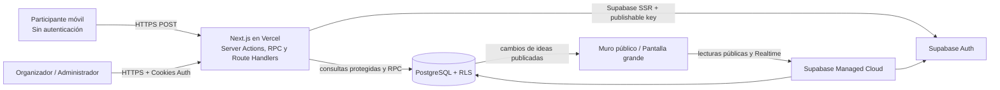

# Arquitectura del sistema

## Resumen

El sistema es una aplicación web construida con Next.js App Router y React, desplegada en Vercel. Supabase provee PostgreSQL, autenticación, políticas Row Level Security (RLS) y Realtime. No hay un backend separado ni un contenedor de aplicación independiente en producción.

## Tecnologías y responsabilidades

| Componente | Tecnología | Responsabilidad |
| --- | --- | --- |
| Interfaz y lógica web | Next.js 16 App Router, React 19, TypeScript | Páginas, formularios, Server Actions, Route Handlers, exportación y renderizado. |
| Hosting | Vercel | Compilar y ejecutar Next.js; despliegues asociados al repositorio GitHub. |
| Identidad y sesiones | Supabase Auth (`@supabase/ssr`) | Cuentas de organizadores, roles administrativos, sesiones en cookies seguras HTTP-only y recuperación de credenciales. |
| Datos y lógica relacional | Supabase PostgreSQL 15+ | Actividades, participantes, ideas, autoría, numeración atómica correlativa, roles globales y registros de auditoría. |
| Frontera de seguridad | RLS y grants PostgreSQL | Aislar actividades por propietario (`owner_id`), restringir funciones administrativas a `admin_global` y limitar columnas expuestas públicamente. |
| Actualización en vivo | Supabase Realtime | Propagar inserciones y cambios de estado de ideas hacia el muro público sin recargar la página. |
| Desarrollo local | Supabase CLI y Docker Desktop/WSL 2 | Ejecutar los servicios locales y aplicar migraciones versionadas. |

La app utiliza `@supabase/ssr` para mantener la sesión de organizador y administrador en cookies. Las Server Actions y los Route Handlers se ejecutan en Next.js. El cliente anónimo en el navegador solo puede leer las columnas expresamente permitidas por SQL y RLS; las claves maestras (`service_role`) jamás se exponen en variables de entorno públicas.

## Flujos principales

### Organizador

1. Se registra o inicia sesión con email y contraseña mediante Supabase Auth.
2. Next.js conserva y renueva la sesión mediante cookies criptográficamente firmadas.
3. El panel consulta actividades y datos privados filtrando bajo el contexto del organizador; RLS valida `owner_id = auth.uid()`.
4. El organizador crea, configura, modera ideas (aprobar/rechazar/ocultar), cambia la modalidad de publicación (`automatic` o `approval`), cierra, reabre o elimina sus actividades.
5. El detalle de actividad permite exportar el conjunto completo de ideas en CSV sanitizado y en presentación interactiva HTML (*Slide Deck*).
6. La recuperación de contraseña envía un enlace seguro que intercambia el código en `/auth/callback` y redirige a `/restablecer-contrasena`.

### Administrador global (`admin_global`)

1. Cuentas específicas habilitadas mediante procedimiento formal de base de datos en la tabla `public.admin_global`.
2. Acceso al panel `/admin` protegido por Server Component con doble barrera de autorización e interrupciones `authInterrupts`.
3. Supervisión transversal de métricas, estados de actividades, moderación forzada y borrado administrativo.
4. Cada acción destructiva o de cambio de estado genera un registro inmutable en `public.audit_logs` con versión de contrato (`contract_version=2`) y conteo previo de cascada.

### Participante y muro público

1. El participante accede a `/a/[code]` desde su dispositivo móvil sin necesidad de registrarse.
2. La Server Action valida los datos con Zod y delega la persistencia a la RPC `submit_idea`.
3. La función SQL valida que la actividad esté abierta, aplica rate limiting (30s) y deduplicación, e inserta de forma atómica al participante, la idea y su autoría. Un trigger asigna el número correlativo atómico `idea_number` por actividad.
4. `/muro/[code]` recibe las ideas publicadas mediante Supabase Realtime y las incorpora a una cola local FIFO.
5. Cada idea se presenta en tarjeta destacada (*Featured*) durante 8 segundos, transiciona durante 700 ms y se incorpora a una grilla armónica híbrida de llenado progresivo (hasta 48 tarjetas visibles).

## Rutas de aplicación

| Ruta | Uso |
| --- | --- |
| `/` | Página pública de presentación y bienvenida. |
| `/crear-cuenta` | Registro de organizadores. |
| `/ingresar` | Inicio de sesión unificado (organizadores y administradores). |
| `/recuperar-contrasena` | Solicitud de correo con enlace de recuperación. |
| `/auth/callback` | Intercambio del código de Auth por cookies de sesión. |
| `/restablecer-contrasena` | Guardado de nueva contraseña con sesión temporal de recuperación. |
| `/panel` | Listado y creación de actividades del organizador. |
| `/panel/actividad/[id]` | Gestión de actividad: compartir, QR, moderación, modalidad, participantes y zona de peligro. |
| `/panel/actividad/[id]/exportar` | Route Handler para descarga de ideas en formatos CSV y HTML interactivo. |
| `/a/[code]` | Formulario móvil de participación para enviar ideas. |
| `/muro/[code]` | Proyección pública en pantalla grande con cola FIFO, tarjeta destacada y grilla armónica. |
| `/admin` | Panel de supervisión y gobernanza para usuarios con rol `admin_global`. |
| `/acerca` | Información institucional, versión y créditos de autoría. |

## Distribución y comportamiento visual del panel

- En el detalle de actividad (`/panel/actividad/[id]`), la maquetación se estructura en un flujo vertical unidimensional (Flexbox `flex-direction: column; width: 100%;`) con separación adaptativa de tarjetas (28px base, 18px en resoluciones compactas y 24px en tablet y móvil).
- El panel permite desplazamiento vertical libre y completo (*scroll* de documento) en todos los tamaños de pantalla, eliminando los candados restrictivos de altura fija (`height: 100vh; overflow: hidden;`) para garantizar el acceso a todos los controles, listas de participantes y la zona de peligro.
- En dispositivos móviles ($\le 650\text{px}$), los controles de cambio de modalidad se reorganizan en disposición vertical al 100% de ancho con botones táctiles de al menos 42px.
- El organizador puede compartir el enlace, copiar la URL o descargar el código QR de participación generado en alta resolución con el isotipo `/muro-mark.svg`.

## Seguridad y límites arquitectónicos

- **Frontera de datos:** La seguridad reside exclusivamente en las políticas RLS y en las funciones PostgreSQL. La clave pública de Supabase no confiere privilegios de bypass.
- **Transaccionalidad:** `submit_idea` opera con `SECURITY DEFINER`, `search_path` estrictamente vacío y privilegios de ejecución controlados.
- **Cascada de eliminación:** La eliminación de una actividad remueve en cascada ideas, participantes y vínculos de autoría.
- **Trazabilidad administrativa:** Las operaciones sobre `/admin` quedan registradas en `audit_logs` registrando el `actor_id`, `action`, contexto, IP del cliente y metadatos JSONB.
- **Defecto conocido de numeración correlativa en cliente anónimo:**
  - En la migración `20261028150000`, la columna `idea_number` se agregó a `ideas` sin incluir `GRANT SELECT (idea_number) ... TO anon;`. Consultas anónimas directas que seleccionen dicha columna requerirán la migración aditiva de subsanación.
  - En `live-wall.tsx`, la consulta de recuperación tras desconexión (*catch-up*) actualmente no incluye `idea_number` en su proyección `.select()`, activando el fallback seguro que oculta el identificador `#N`.

## Evolución y gobernanza documental

Cualquier cambio que afecte esquemas relacionales, grants o políticas RLS debe implementarse como migración SQL versionada en `supabase/migrations/` y reflejarse de forma estricta en [modelo-de-datos.md](modelo-de-datos.md) y en [ESTADO_ACTUAL_Y_HOJA_DE_RUTA.md](ESTADO_ACTUAL_Y_HOJA_DE_RUTA.md).
